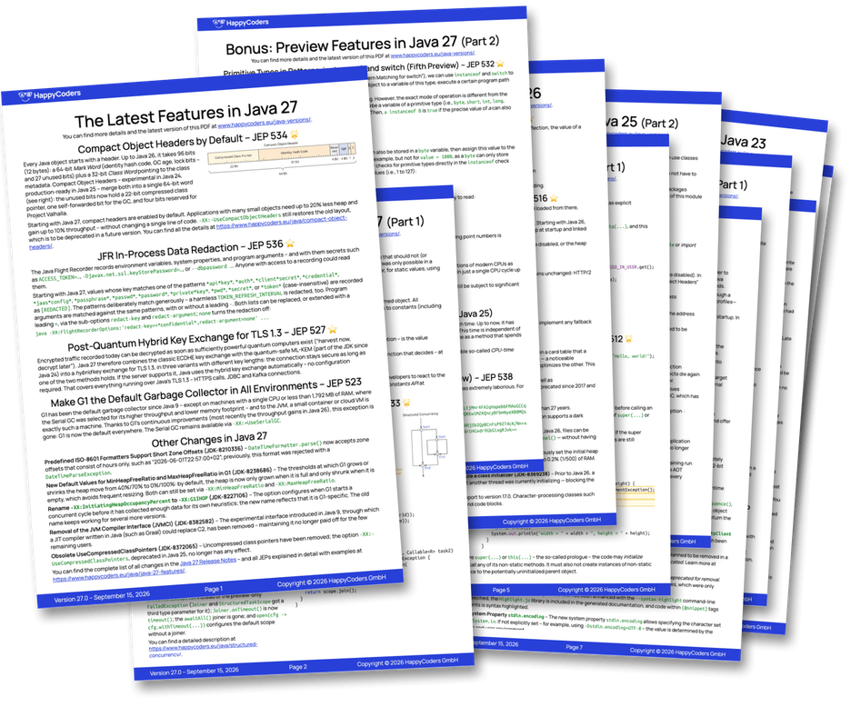
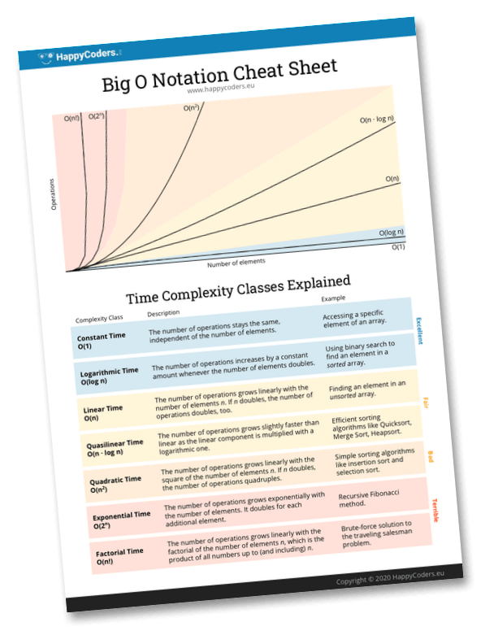
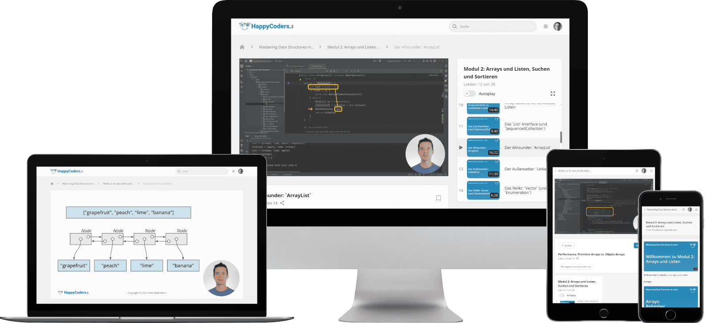

# Application Class-Data Sharing (AppCDS) Demo

A minimal application for demostrating application class-data sharing (AppCDS). This repository is referenced from the following HappyCoders article on new features in Java 10:

* English: [Java 10 Features (With Examples)](https://www.happycoders.eu/java/java-10-features/)
* German: [Java 10 Features (mit Beispielen)](https://www.happycoders.eu/de/java/java-10-features/)

You need at least Java 10, preferably OpenJDK, since AppCDS is a commercial feature in the Oracle JDK.

To run the application using AppCDS, follow these steps:

## Step 1

Compile and package the code.

```
javac -d target/classes src/eu/happycoders/appcds/*.java
jar cf target/helloworld.jar -C target/classes .
```

## Step 2

Create a list of classes that the application uses.

(On Windows, you must omit the backslashes and write everything on one line.)

```
java -Xshare:off -XX:+UseAppCDS \
    -XX:DumpLoadedClassList=helloworld.lst \
    -cp target/helloworld.jar eu.happycoders.appcds.Main
```

As the program is executed to created the class list, you should see a "Hello world!".

## Step 3

Create a JSA file (Java shared archive) from the class list.

```
java -Xshare:dump -XX:+UseAppCDS \
    -XX:SharedClassListFile=helloworld.lst \
    -XX:SharedArchiveFile=helloworld.jsa \
    -cp target/helloworld.jar
```

## Step 4

Run the application with the AppCDS activated.

```
java -Xshare:on -XX:+UseAppCDS \
    -XX:SharedArchiveFile=helloworld.jsa \
    -cp target/helloworld.jar eu.happycoders.appcds.Main
```

You should see "Hello world!" again.


<!-- happycoders-resources:start -->
<!-- Generated from happycoders-website-astro/data/github-readme by scripts/content/sync-github-readmes.mjs. Edit there, not here. -->

## <br>Additional Resources

### <br>Java Versions PDF Cheat Sheet

**Stay up-to-date** with the latest Java features with this **free** [PDF Cheat Sheet](https://www.happycoders.eu/java-versions/)!

[](https://www.happycoders.eu/java-versions/)

* Avoid lengthy research with this **concise overview of all Java versions from Java 10 to Java 27**.
* **Discover the innovative features** of each new Java version, summarized on a single page.
* **Impress your team** with your up-to-date knowledge of the latest Java version.

👉 [Download the free Java Versions PDF](https://www.happycoders.eu/java-versions/)<br>

_(Hier geht's zur deutschen Version &rarr; [Java-Versionen PDF](https://www.happycoders.eu/de/java-versionen/))_


### <br>The Big O Cheat Sheet

With this **free** [1-page PDF cheat sheet](https://www.happycoders.eu/big-o-cheat-sheet/), you'll always have the **7 most important complexity classes** at a glance.

[](https://www.happycoders.eu/big-o-cheat-sheet/)

* **Always choose the most efficient data structures** and thus increase the performance of your applications.
* **Be prepared for technical interviews** and confidently present your algorithm knowledge.
* **Become a sought-after problem solver** and be known for systematically tackling complex problems.

👉 [Download the free Big O Cheat Sheet](https://www.happycoders.eu/big-o-cheat-sheet/)<br>

_(Hier geht's zur deutschen Version &rarr; [O-Notation Cheat Sheet](https://www.happycoders.eu/de/o-notation-cheat-sheet/))_


### <br>HappyCoders Newsletter
👉 Want to stay on top of modern Java?
Sign up for the [HappyCoders newsletter](https://www.happycoders.eu/newsletter/) – Modern Java: new versions & features, performance, and JVM insights – once a month.

_(Hier geht's zur deutschen Version &rarr; [HappyCoders-Newsletter deutsch](https://www.happycoders.eu/de/newsletter/))_


### <br>🇩🇪 An alle Java-Entwickler:innen, die durch fundierte Kenntnisse über Datenstrukturen besseren Code schreiben wollen

Trage dich jetzt unverbindlich auf die [Warteliste](https://www.happycoders.eu/de/mastering-data-structures-warteliste/) von „Mastering Data Structures in Java“ ein, und erhalte das beste Angebot!

[](https://www.happycoders.eu/de/mastering-data-structures-warteliste/)

👉 [Zur Warteliste](https://www.happycoders.eu/de/mastering-data-structures-warteliste/)
<!-- happycoders-resources:end -->
